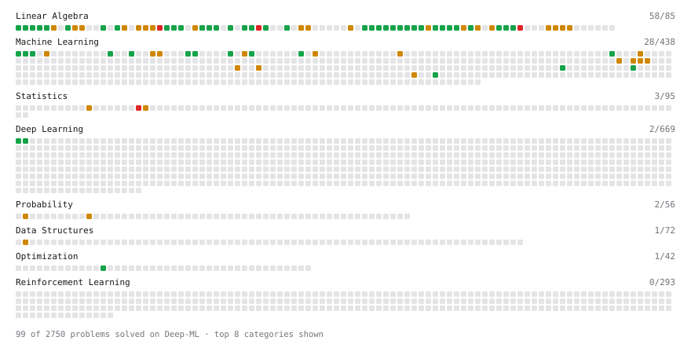

# Deep-ML

My machine learning practice from [Deep-ML](https://www.deep-ml.com). Every solution here was written by hand.

**117** solved · 88 problems · 0 labs · 29 math

[**Browse the interactive portfolio**](https://Yashi11.github.io/deep-ml-solutions/) to replay this filling in over time.

## Problems

| | Difficulty | Solved | |
| --- | --- | --- | --- |
| [Calculate 2x2 Matrix Inverse](https://www.deep-ml.com/problems/8) | easy | 2026-11-11 | [solution](problems/0008-calculate-2x2-matrix-inverse) |
| [Calculate Cosine Similarity Between Vectors](https://www.deep-ml.com/problems/76) | easy | 2026-11-14 | [solution](problems/0076-calculate-cosine-similarity-between-vectors) |
| [Calculate Mean Absolute Error (MAE)](https://www.deep-ml.com/problems/93) | easy | 2026-11-22 | [solution](problems/0093-calculate-mean-absolute-error-mae) |
| [Calculate Mean by Row or Column](https://www.deep-ml.com/problems/4) | easy | 2026-11-13 | [solution](problems/0004-calculate-mean-by-row-or-column) |
| [Calculate R-squared for Regression Analysis](https://www.deep-ml.com/problems/69) | easy | 2026-11-22 | [solution](problems/0069-calculate-r-squared-for-regression-analysis) |
| [Calculate Root Mean Square Error (RMSE)](https://www.deep-ml.com/problems/71) | easy | 2026-11-22 | [solution](problems/0071-calculate-root-mean-square-error-rmse) |
| [Check Linear Independence of Vectors](https://www.deep-ml.com/problems/331) | easy | 2026-11-14 | [solution](problems/0331-check-linear-independence-of-vectors) |
| [Compute the Cross Product of Two 3D Vectors](https://www.deep-ml.com/problems/118) | easy | 2026-11-14 | [solution](problems/0118-compute-the-cross-product-of-two-3d-vectors) |
| [Convert Vector to Diagonal Matrix](https://www.deep-ml.com/problems/35) | easy | 2026-11-14 | [solution](problems/0035-convert-vector-to-diagonal-matrix) |
| [Derivative of a Polynomial](https://www.deep-ml.com/problems/116) | easy | 2026-11-20 | [solution](problems/0116-derivative-of-a-polynomial) |
| [Detect Overfitting or Underfitting](https://www.deep-ml.com/problems/86) | easy | 2026-11-22 | [solution](problems/0086-detect-overfitting-or-underfitting) |
| [Dot Product Calculator](https://www.deep-ml.com/problems/83) | easy | 2026-11-07 | [solution](problems/0083-dot-product-calculator) |
| [Feature Scaling Implementation](https://www.deep-ml.com/problems/16) | easy | 2026-11-21 | [solution](problems/0016-feature-scaling-implementation) |
| [Gradient Direction and Magnitude](https://www.deep-ml.com/problems/308) | easy | 2026-11-20 | [solution](problems/0308-gradient-direction-and-magnitude) |
| [Implement Compressed Column Sparse Matrix Format (CSC)](https://www.deep-ml.com/problems/67) | easy | 2026-11-14 | [solution](problems/0067-implement-compressed-column-sparse-matrix-format-csc) |
| [Implement Compressed Row Sparse Matrix (CSR) Format Conversion](https://www.deep-ml.com/problems/65) | easy | 2026-11-14 | [solution](problems/0065-implement-compressed-row-sparse-matrix-csr-format-conversion) |
| [Implement Orthogonal Projection of a Vector onto a Line](https://www.deep-ml.com/problems/66) | easy | 2026-11-14 | [solution](problems/0066-implement-orthogonal-projection-of-a-vector-onto-a-line) |
| [Implement Ridge Regression Loss Function](https://www.deep-ml.com/problems/43) | easy | 2026-11-24 | [solution](problems/0043-implement-ridge-regression-loss-function) |
| [L2 Normalization Along an Axis](https://www.deep-ml.com/problems/1022) | easy | 2026-11-15 | [solution](problems/1022-l2-normalization-along-an-axis) |
| [Learning Rate Range Finder for Linear Regression](https://www.deep-ml.com/problems/990) | easy | 2026-11-20 | [solution](problems/0990-learning-rate-range-finder-for-linear-regression) |
| [Linear Regression Using Gradient Descent](https://www.deep-ml.com/problems/15) | easy | 2026-11-19 | [solution](problems/0015-linear-regression-using-gradient-descent) |
| [Linear Regression Using Normal Equation](https://www.deep-ml.com/problems/14) | easy | 2026-11-19 | [solution](problems/0014-linear-regression-using-normal-equation) |
| [Matrix Determinant & Trace](https://www.deep-ml.com/problems/195) | easy | 2026-11-14 | [solution](problems/0195-matrix-determinant-trace) |
| [Matrix-Vector Dot Product](https://www.deep-ml.com/problems/1) | easy | 2026-11-07 | [solution](problems/0001-matrix-vector-dot-product) |
| [One-Hot Encoding of Nominal Values](https://www.deep-ml.com/problems/34) | easy | 2026-11-21 | [solution](problems/0034-one-hot-encoding-of-nominal-values) |
| [Phi Transformation for Polynomial Features](https://www.deep-ml.com/problems/84) | easy | 2026-11-14 | [solution](problems/0084-phi-transformation-for-polynomial-features) |
| [Random Rotation Matrix and a Rotation Layer](https://www.deep-ml.com/problems/1190) | easy | 2026-11-15 | [solution](problems/1190-random-rotation-matrix-and-a-rotation-layer) |
| [Random Train/Validation/Test Split with Shuffling](https://www.deep-ml.com/problems/1058) | easy | 2026-11-21 | [solution](problems/1058-random-train-validation-test-split-with-shuffling) |
| [Recursive Least Squares for Simple Linear Regression](https://www.deep-ml.com/problems/1820) | easy | 2026-11-20 | [solution](problems/1820-recursive-least-squares-for-simple-linear-regression) |
| [Reshape Matrix](https://www.deep-ml.com/problems/3) | easy | 2026-11-13 | [solution](problems/0003-reshape-matrix) |
| [Row-Normalize a Count Matrix to Probabilities](https://www.deep-ml.com/problems/985) | easy | 2026-11-14 | [solution](problems/0985-row-normalize-a-count-matrix-to-probabilities) |
| [Scalar Multiplication of a Matrix](https://www.deep-ml.com/problems/5) | easy | 2026-11-13 | [solution](problems/0005-scalar-multiplication-of-a-matrix) |
| [Smooth L1 Loss with a Beta Parameter](https://www.deep-ml.com/problems/1372) | easy | 2026-11-22 | [solution](problems/1372-smooth-l1-loss-with-a-beta-parameter) |
| [Tensor Puzzle: Circular Roll by One](https://www.deep-ml.com/problems/1277) | easy | 2026-11-17 | [solution](problems/1277-tensor-puzzle-circular-roll-by-one) |
| [Tensor Puzzle: Extract the Diagonal](https://www.deep-ml.com/problems/1271) | easy | 2026-11-17 | [solution](problems/1271-tensor-puzzle-extract-the-diagonal) |
| [Tensor Puzzle: First-Order Difference](https://www.deep-ml.com/problems/1275) | easy | 2026-11-16 | [solution](problems/1275-tensor-puzzle-first-order-difference) |
| [Tensor Puzzle: Heaviside Step with Zero-Value](https://www.deep-ml.com/problems/1286) | easy | 2026-11-16 | [solution](problems/1286-tensor-puzzle-heaviside-step-with-zero-value) |
| [Tensor Puzzle: Identity Matrix from Comparisons](https://www.deep-ml.com/problems/1272) | easy | 2026-11-17 | [solution](problems/1272-tensor-puzzle-identity-matrix-from-comparisons) |
| [Tensor Puzzle: Linspace from Endpoints](https://www.deep-ml.com/problems/1285) | easy | 2026-11-16 | [solution](problems/1285-tensor-puzzle-linspace-from-endpoints) |
| [Tensor Puzzle: Ones Vector from First Principles](https://www.deep-ml.com/problems/1268) | easy | 2026-11-15 | [solution](problems/1268-tensor-puzzle-ones-vector-from-first-principles) |
| [Tensor Puzzle: Outer Product via Broadcasting](https://www.deep-ml.com/problems/1270) | easy | 2026-11-15 | [solution](problems/1270-tensor-puzzle-outer-product-via-broadcasting) |
| [Tensor Puzzle: Pad or Truncate a Vector to Length j](https://www.deep-ml.com/problems/1280) | easy | 2026-11-17 | [solution](problems/1280-tensor-puzzle-pad-or-truncate-a-vector-to-length-j) |
| [Tensor Puzzle: Repeat a Vector as Rows](https://www.deep-ml.com/problems/1287) | easy | 2026-11-16 | [solution](problems/1287-tensor-puzzle-repeat-a-vector-as-rows) |
| [Tensor Puzzle: Reverse a Vector](https://www.deep-ml.com/problems/1278) | easy | 2026-11-17 | [solution](problems/1278-tensor-puzzle-reverse-a-vector) |
| [Tensor Puzzle: Stack Two Vectors as Rows](https://www.deep-ml.com/problems/1276) | easy | 2026-11-16 | [solution](problems/1276-tensor-puzzle-stack-two-vectors-as-rows) |
| [Tensor Puzzle: Sum a Vector with a Dot Product](https://www.deep-ml.com/problems/1269) | easy | 2026-11-15 | [solution](problems/1269-tensor-puzzle-sum-a-vector-with-a-dot-product) |
| [Tensor Puzzle: Upper-Triangular Ones Matrix](https://www.deep-ml.com/problems/1273) | easy | 2026-11-17 | [solution](problems/1273-tensor-puzzle-upper-triangular-ones-matrix) |
| [Transformation Matrix from Basis B to C](https://www.deep-ml.com/problems/27) | easy | 2026-11-14 | [solution](problems/0027-transformation-matrix-from-basis-b-to-c) |
| [Transpose of a Matrix](https://www.deep-ml.com/problems/2) | easy | 2026-11-07 | [solution](problems/0002-transpose-of-a-matrix) |
| [Vector Element-wise Sum](https://www.deep-ml.com/problems/121) | easy | 2026-11-04 | [solution](problems/0121-vector-element-wise-sum) |
| [Vector Norms (L1/L2/L-inf) and the Frobenius Norm](https://www.deep-ml.com/problems/328) | easy | 2026-11-14 | [solution](problems/0328-vector-norms-l1-l2-l-inf-and-the-frobenius-norm) |
| [2D Translation Matrix Implementation](https://www.deep-ml.com/problems/55) | medium | 2026-11-17 | [solution](problems/0055-2d-translation-matrix-implementation) |
| [Bayesian Linear Regression: Sequential Posterior and Predictive Bands](https://www.deep-ml.com/problems/1817) | medium | 2026-11-20 | [solution](problems/1817-bayesian-linear-regression-sequential-posterior-and-predictive-bands) |
| [Calculate Correlation Matrix](https://www.deep-ml.com/problems/37) | medium | 2026-11-18 | [solution](problems/0037-calculate-correlation-matrix) |
| [Calculate Eigenvalues of a Matrix](https://www.deep-ml.com/problems/6) | medium | 2026-11-14 | [solution](problems/0006-calculate-eigenvalues-of-a-matrix) |
| [Chain Rule for Composite Functions](https://www.deep-ml.com/problems/214) | medium | 2026-11-20 | [solution](problems/0214-chain-rule-for-composite-functions) |
| [Cholesky at Work: Triangular Solves, Log-Determinant and MVN Sampling](https://www.deep-ml.com/problems/1776) | medium | 2026-11-16 | [solution](problems/1776-cholesky-at-work-triangular-solves-log-determinant-and-mvn-sampling) |
| [Cholesky Decomposition](https://www.deep-ml.com/problems/334) | medium | 2026-11-13 | [solution](problems/0334-cholesky-decomposition) |
| [Compute Grassmann Distance Between Subspaces](https://www.deep-ml.com/problems/875) | medium | 2026-11-17 | [solution](problems/0875-compute-grassmann-distance-between-subspaces) |
| [Create Composite Hypervector for a Dataset Row](https://www.deep-ml.com/problems/74) | medium | 2026-11-17 | [solution](problems/0074-create-composite-hypervector-for-a-dataset-row) |
| [Cross-Validated Prediction with K-Fold Linear Regression](https://www.deep-ml.com/problems/839) | medium | 2026-11-22 | [solution](problems/0839-cross-validated-prediction-with-k-fold-linear-regression) |
| [Gauss-Seidel Method for Solving Linear Systems](https://www.deep-ml.com/problems/57) | medium | 2026-11-18 | [solution](problems/0057-gauss-seidel-method-for-solving-linear-systems) |
| [Gaussian Elimination for Solving Linear Systems](https://www.deep-ml.com/problems/58) | medium | 2026-11-13 | [solution](problems/0058-gaussian-elimination-for-solving-linear-systems) |
| [Handle Missing Data with Imputation](https://www.deep-ml.com/problems/354) | medium | 2026-11-22 | [solution](problems/0354-handle-missing-data-with-imputation) |
| [Implement Gradient Descent Variants with MSE Loss](https://www.deep-ml.com/problems/47) | medium | 2026-11-19 | [solution](problems/0047-implement-gradient-descent-variants-with-mse-loss) |
| [Implement K-Fold Cross-Validation](https://www.deep-ml.com/problems/18) | medium | 2026-11-24 | [solution](problems/0018-implement-k-fold-cross-validation) |
| [Implement Lasso Regression using ISTA](https://www.deep-ml.com/problems/50) | medium | 2026-11-24 | [solution](problems/0050-implement-lasso-regression-using-ista) |
| [Implement the Huber Loss Function](https://www.deep-ml.com/problems/192) | medium | 2026-11-22 | [solution](problems/0192-implement-the-huber-loss-function) |
| [Learning Curve Generator for Bias-Variance Diagnosis](https://www.deep-ml.com/problems/800) | medium | 2026-11-22 | [solution](problems/0800-learning-curve-generator-for-bias-variance-diagnosis) |
| [Least-Norm Solution of an Underdetermined System](https://www.deep-ml.com/problems/1777) | medium | 2026-11-16 | [solution](problems/1777-least-norm-solution-of-an-underdetermined-system) |
| [Linear Regression - Power Grid Optimization](https://www.deep-ml.com/problems/92) | medium | 2026-11-20 | [solution](problems/0092-linear-regression-power-grid-optimization) |
| [LU Decomposition of a Square Matrix](https://www.deep-ml.com/problems/333) | medium | 2026-11-13 | [solution](problems/0333-lu-decomposition-of-a-square-matrix) |
| [Matrix times Matrix ](https://www.deep-ml.com/problems/9) | medium | 2026-11-07 | [solution](problems/0009-matrix-times-matrix) |
| [Mini-Batch Gradient Descent Step for Linear Regression](https://www.deep-ml.com/problems/803) | medium | 2026-11-20 | [solution](problems/0803-mini-batch-gradient-descent-step-for-linear-regression) |
| [Numerical Gradient Checking](https://www.deep-ml.com/problems/313) | medium | 2026-11-20 | [solution](problems/0313-numerical-gradient-checking) |
| [Partial Derivatives of Multivariable Functions](https://www.deep-ml.com/problems/215) | medium | 2026-11-20 | [solution](problems/0215-partial-derivatives-of-multivariable-functions) |
| [Partitioned Inverse via Schur Complements](https://www.deep-ml.com/problems/1775) | medium | 2026-11-13 | [solution](problems/1775-partitioned-inverse-via-schur-complements) |
| [Solve Linear Equations using Jacobi Method](https://www.deep-ml.com/problems/11) | medium | 2026-11-18 | [solution](problems/0011-solve-linear-equations-using-jacobi-method) |
| [StandardScaler Fit and Transform](https://www.deep-ml.com/problems/842) | medium | 2026-11-21 | [solution](problems/0842-standardscaler-fit-and-transform) |
| [Stochastic Gradient Descent Step for Linear Regression](https://www.deep-ml.com/problems/802) | medium | 2026-11-20 | [solution](problems/0802-stochastic-gradient-descent-step-for-linear-regression) |
| [Tensor Puzzle: Bincount by Scatter-Add](https://www.deep-ml.com/problems/1282) | medium | 2026-11-18 | [solution](problems/1282-tensor-puzzle-bincount-by-scatter-add) |
| [Tensor Puzzle: Compress — Keep True Positions](https://www.deep-ml.com/problems/1279) | medium | 2026-11-17 | [solution](problems/1279-tensor-puzzle-compress-keep-true-positions) |
| [Tensor Puzzle: Cumulative Sum via Triangular Matmul](https://www.deep-ml.com/problems/1274) | medium | 2026-11-17 | [solution](problems/1274-tensor-puzzle-cumulative-sum-via-triangular-matmul) |
| [Tensor Puzzle: Flatten a Matrix by Indexing](https://www.deep-ml.com/problems/1284) | medium | 2026-11-18 | [solution](problems/1284-tensor-puzzle-flatten-a-matrix-by-indexing) |
| [Woodbury, Sherman-Morrison and the Determinant Lemma](https://www.deep-ml.com/problems/1774) | medium | 2026-11-13 | [solution](problems/1774-woodbury-sherman-morrison-and-the-determinant-lemma) |
| [Implement the Conjugate Gradient Method for Solving Linear Systems](https://www.deep-ml.com/problems/63) | hard | 2026-11-16 | [solution](problems/0063-implement-the-conjugate-gradient-method-for-solving-linear-systems) |
| [QR Decomposition](https://www.deep-ml.com/problems/201) | hard | 2026-11-14 | [solution](problems/0201-qr-decomposition) |
| [Tensor Puzzle: Bucketize Values into Bins](https://www.deep-ml.com/problems/1288) | hard | 2026-11-17 | [solution](problems/1288-tensor-puzzle-bucketize-values-into-bins) |

## Math

| | Difficulty | Solved | |
| --- | --- | --- | --- |
| [Derivatives and Gradients](https://www.deep-ml.com/math-problems/1) | easy | 2026-11-19 | [solution](math/0001-derivatives-and-gradients) |
| [Expectation and Variance Algebra](https://www.deep-ml.com/math-problems/33) | easy | 2026-11-22 | [solution](math/0033-expectation-and-variance-algebra) |
| [Gradient Descent Updates](https://www.deep-ml.com/math-problems/5) | easy | 2026-11-19 | [solution](math/0005-gradient-descent-updates) |
| [Matrix Basics](https://www.deep-ml.com/math-problems/9) | easy | 2026-11-04 | [solution](math/0009-matrix-basics) |
| [ML Workflow Basics](https://www.deep-ml.com/math-problems/30) | easy | 2026-11-21 | [solution](math/0030-ml-workflow-basics) |
| [Model Selection: CV, AIC, and BIC](https://www.deep-ml.com/math-problems/43) | easy | 2026-11-23 | [solution](math/0043-model-selection-cv-aic-and-bic) |
| [Probability Fundamentals](https://www.deep-ml.com/math-problems/19) | easy | 2026-11-22 | [solution](math/0019-probability-fundamentals) |
| [Vector Operations](https://www.deep-ml.com/math-problems/7) | easy | 2026-11-04 | [solution](math/0007-vector-operations) |
| [Why Minibatches: Gradient Variance vs Batch Size](https://www.deep-ml.com/math-problems/130) | easy | 2026-11-20 | [solution](math/0130-why-minibatches-gradient-variance-vs-batch-size) |
| [Bayesian Linear Regression: Posterior and Posterior Predictive](https://www.deep-ml.com/math-problems/454) | medium | 2026-11-20 | [solution](math/0454-bayesian-linear-regression-posterior-and-posterior-predictive) |
| [Bias–Variance Decomposition](https://www.deep-ml.com/math-problems/39) | medium | 2026-11-23 | [solution](math/0039-bias-variance-decomposition) |
| [Common Distributions II: Normal, Poisson, Exponential](https://www.deep-ml.com/math-problems/22) | medium | 2026-11-23 | [solution](math/0022-common-distributions-ii-normal-poisson-exponential) |
| [Condition Numbers: Why the Determinant Lies About Near-Singularity](https://www.deep-ml.com/math-problems/412) | medium | 2026-11-13 | [solution](math/0412-condition-numbers-why-the-determinant-lies-about-near-singularity) |
| [Inverse and Rank](https://www.deep-ml.com/math-problems/12) | medium | 2026-11-08 | [solution](math/0012-inverse-and-rank) |
| [Law of Large Numbers and Central Limit Theorem](https://www.deep-ml.com/math-problems/23) | medium | 2026-11-23 | [solution](math/0023-law-of-large-numbers-and-central-limit-theorem) |
| [Least Squares and the Normal Equations](https://www.deep-ml.com/math-problems/34) | medium | 2026-11-19 | [solution](math/0034-least-squares-and-the-normal-equations) |
| [Matrix Multiplication](https://www.deep-ml.com/math-problems/10) | medium | 2026-11-04 | [solution](math/0010-matrix-multiplication) |
| [Multivariate Calculus](https://www.deep-ml.com/math-problems/2) | medium | 2026-11-20 | [solution](math/0002-multivariate-calculus) |
| [Optimization: Convexity and Critical Points](https://www.deep-ml.com/math-problems/6) | medium | 2026-11-22 | [solution](math/0006-optimization-convexity-and-critical-points) |
| [Orthogonality and Projections](https://www.deep-ml.com/math-problems/14) | medium | 2026-11-19 | [solution](math/0014-orthogonality-and-projections) |
| [Positive Definite Matrices and Quadratic Forms](https://www.deep-ml.com/math-problems/50) | medium | 2026-11-22 | [solution](math/0050-positive-definite-matrices-and-quadratic-forms) |
| [Regularization and Generalization](https://www.deep-ml.com/math-problems/31) | medium | 2026-11-23 | [solution](math/0031-regularization-and-generalization) |
| [Schur Complements and the Partitioned Inverse](https://www.deep-ml.com/math-problems/409) | medium | 2026-11-09 | [solution](math/0409-schur-complements-and-the-partitioned-inverse) |
| [Solving Linear Systems](https://www.deep-ml.com/math-problems/13) | medium | 2026-11-13 | [solution](math/0013-solving-linear-systems) |
| [Training Error, Test Error and the Bayes Rate](https://www.deep-ml.com/math-problems/104) | medium | 2026-11-22 | [solution](math/0104-training-error-test-error-and-the-bayes-rate) |
| [Vector Norms and Linear Independence](https://www.deep-ml.com/math-problems/8) | medium | 2026-11-04 | [solution](math/0008-vector-norms-and-linear-independence) |
| [Woodbury, Sherman-Morrison and the Matrix Determinant Lemma](https://www.deep-ml.com/math-problems/410) | medium | 2026-11-11 | [solution](math/0410-woodbury-sherman-morrison-and-the-matrix-determinant-lemma) |
| [Matrix Decompositions: LU and QR](https://www.deep-ml.com/math-problems/15) | hard | 2026-11-13 | [solution](math/0015-matrix-decompositions-lu-and-qr) |
| [Ridge vs Lasso: Constraint Geometry and Soft-Thresholding](https://www.deep-ml.com/math-problems/94) | hard | 2026-11-23 | [solution](math/0094-ridge-vs-lasso-constraint-geometry-and-soft-thresholding) |

---

_This file is regenerated by Deep-ML on every push._
